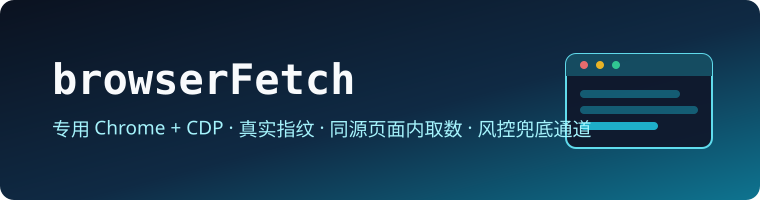

<p align="center">
  
</p>

# dsh-rss-news-browser-fetch

> 「浏览器传输」——dsh 基建服务插件：专用 Chrome 实例 + CDP（Chrome DevTools Protocol），为其他插件提供「在用户本机真实浏览器会话内发请求」的能力（持久 cookie、同源页面内取数），兜底对 Node 请求响应不稳定的数据源。

中文 | [English](./README.en.md)

[](https://www.npmjs.com/package/dsh-rss-news-browser-fetch)
[](LICENSE)

`browserFetch` 是 dsh 插件生态的**服务插件**——自身不做任何抓取业务，只向其他插件提供「在用户本机真实浏览器页面里执行 fetch」的能力。部分源端接口对非浏览器请求响应不稳定（超时/报错/返回需执行 JS 的页面），此时自动回落浏览器通道作兼容兜底。零运行时依赖、无 Selenium/Puppeteer。

## 它解决什么问题

部分数据接口对非浏览器客户端的响应不稳定——插件的 node `fetch` 会连接挂起、报错，或拿到一个需要执行 JS 才有内容的页面。`browserFetch` 经 CDP 在真实 Chrome tab 内执行 `fetch()`：请求发自用户自己的浏览器会话，同源上下文无 CORS 限制、自动携带该域 cookie——与用户在浏览器里手动打开页面等效。

## 功能

- **专用 Chrome 实例**：懒拉起（首次 fetch 才启动），独立持久 profile——cookie/登录态与日常浏览器完全隔离，登录一次长期有效
- **域白名单**：调用方 `declareDomains` 显式声明可抓域，只放行声明过的精确 host（同源语义），无开放代理面
- **域→tab 池**：每个 API 域一个轻量同源页（默认 `robots.txt`，失败自动回退域根页），页面内 fetch 走 `Runtime.evaluate`
- **授权流**：adapter 判定需要登录/交互验证后 `markAuthRequired`，`openForAuth` 把 tab 顶到前台，由**用户本人**像日常浏览一样完成登录/验证；授权中自动暂停漂移巡检
- **watchdog**：周期巡检——tab 被关自动重建、URL 漂移自动拉回、实例崩溃自动重拉；用户连续关闭 ≥3 次转为暂停（尊重用户意愿），设置页可手动恢复
- **冷启动静默**：worker 路径拉起时窗口最小化——浏览器传输是无声基建
- **设置页**：`/dsh-rss-news-browser-fetch/` 查看实例/域/授权状态、「打开 Chrome」调试入口、「清除所有数据」（cookie/登录态/声明全清）

## 安装

```bash
dsh plugin --profile <你的profile名> add dsh-rss-news-browser-fetch
```

需要一个 Chromium 系浏览器（自动探测：Chrome / Edge / Chromium / Brave，支持 macOS / Windows / Linux）。

## 消费方式（插件开发者）

```ts
export function apply(ctx: Context) {
  ctx.inject(['browserFetch'], (c) => {
    const bf = c.browserFetch // 可选依赖：未装则降级纯 node fetch
    bf.declareDomains('my-plugin', ['api.example.com'])
    const r = await bf.fetch('api.example.com', 'https://api.example.com/list')
    // r = { status, body }——在 api.example.com 的同源页内执行
  })
}
```

| API | 说明 |
|---|---|
| `declareDomains(caller, domains)` | 声明可 fetch 的域（并集白名单，caller 自报仅作审计） |
| `fetch(domain, url, init?)` | 域同源页内执行 fetch，返回 `{ status, body }` |
| `markAuthRequired(domain, on?)` | 标记/清除「需用户授权」（登录墙/交互验证命中时） |
| `authRequired(domain)` | 查询域是否待授权 |
| `openForAuth(domain, url?)` | 把域 tab 顶到前台让用户登录/过验证 |
| `resume()` / `status()` | 手动恢复暂停实例 / 状态查询 |

服务名：`browserFetch` · apiVersion: 2

> 使用注意：本服务访问的是用户本可在浏览器中手动打开的页面；调用方插件及最终用户应自行确认并遵守目标站点的访问条款。

## 内部说明

- cordis entry id：`rss-news-browser-fetch`；提供服务名 `browserFetch`
- 数据目录：`~/.dsh/rss-news-browser-fetch/`（专用 Chrome profile 所在地；设了 `DSH_HOME` 则在 `$DSH_HOME/data/` 下）
- 实例状态 `instance.json`：记录 pid+调试端口。宿主崩溃/被杀后 Chrome 成为孤儿并占着 profile 单例锁——下次启动按它收割孤儿（SIGTERM→SIGKILL），避免「单例交接后即刻退出」让每次首抓都失败
- watchdog 计数语义：用户连关 3 次转暂停；自动重拉不清零计数，只有设置页「重新启用」（`resume()`）清零——否则高频抓取下暂停永远触发不了
- Chrome 136+ 硬约束：`--remote-debugging-port` 仅在非默认 `--user-data-dir` 生效——这正是独立 profile 存在的技术原因之一
- CDP 威胁模型：调试端口仅绑 127.0.0.1 且 CDP 本身无鉴权——本机任意进程可接管该专用实例（读 cookie/任意 evaluate）。专用 profile 把爆炸半径限制在抓取 cookie 范围内；设置页 API 只服务 loopback Host（防 DNS 重绑定）+ Origin 同源校验，`/api/clear` 需服务端确认 `confirm:true`
- 极简 CDP client：Node ≥22.18 自带 WebSocket，零依赖
- 已知消费方：[dsh-rss-news-flash-kuaixun](https://github.com/terry2010/dsh-rss-news-flash-kuaixun)——node fetch 优先、失败自动回落浏览器通道

## 相关插件

- **[dsh-rss-news-daily](https://github.com/terry2010/dsh-rss-news-daily)** —— RSS 订阅 + AI 每日精选/时段快报 + 侧栏新闻阅读器
- **[dsh-rss-news-flash-kuaixun](https://github.com/terry2010/dsh-rss-news-flash-kuaixun)** —— 实时财经快讯伴随插件：已知消费方，node fetch 优先、失败自动回落本服务

## License

Apache-2.0 — 见 [LICENSE](./LICENSE)
